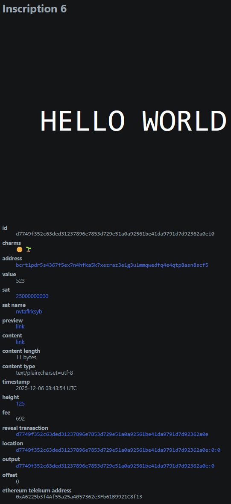
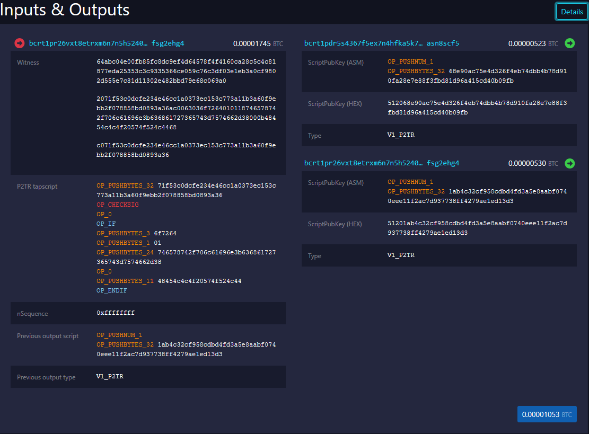
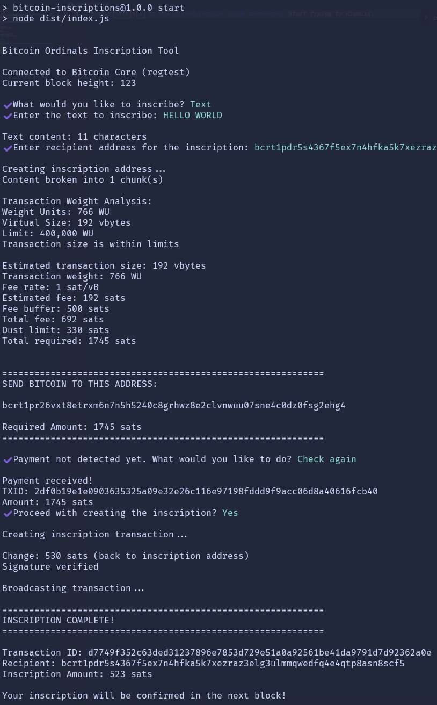

# Bitcoin Inscriptions

A comprehensive TypeScript implementation demonstrating how Bitcoin Ordinals inscriptions work. This project provides both an interactive CLI tool for hands-on experimentation and a minimal example showcasing the core inscription logic.

## Getting Started

### Prerequisites

- Node.js (v24)
- Bitcoin Core with regtest mode

For a complete Bitcoin development environment setup, we recommend following this guide: <https://github.com/AlstonChan/bitcoin-development-environment-setup>

### Installation

1. Clone the repository

   ```bash
   git clone https://github.com/AlstonChan/bitcoin-inscriptions.git
   cd bitcoin-inscriptions
   ```

2. Install dependencies

   ```bash
   npm install
   ```

3. Build the project

   ```bash
   npm run build
   ```

4. Run the application

Interactive CLI mode (recommended for testing):

```bash
npm start
```

Minimal example with hardcoded values:

```bash
npm run start:minimal
```

## How Bitcoin Inscriptions Work

Bitcoin inscriptions, also known as Ordinals, allow arbitrary data to be embedded into Bitcoin transactions using Taproot script paths. The process involves:

1. **Content Preparation**: The data to be inscribed (text, image, etc.) is prepared and chunked into 520-byte segments to comply with Bitcoin script push limits.

2. **Tapscript Construction**: A Taproot script is created containing:

   - Public key and signature verification
   - Ordinals envelope with content type and data
   - Optional metadata and parent inscription references

3. **Address Generation**: A Pay-to-Taproot (P2TR) address is generated with the tapscript committed to the script tree.

4. **Funding**: Bitcoin is sent to the inscription address to fund the transaction.

5. **Transaction Creation**: A Bitcoin transaction is constructed that:

   - Spends from the funded inscription address
   - Uses script path spending to reveal the inscription data
   - Sends the inscribed satoshi to the recipient address

6. **Broadcasting**: The signed transaction is broadcast to the Bitcoin network, permanently inscribing the data on-chain.

## Project Structure

- `src/index.ts`: Interactive CLI application with user prompts
- `src/minimal.ts`: Minimal inscription example with hardcoded values
- `src/lib/misc.ts`: Utility functions for key derivation and transaction finalization
- `assets/`: Directory for storing files to be inscribed

## Features

- Interactive CLI with step-by-step guidance
- Support for text and file inscriptions
- Automatic content type detection
- Large file handling with proper chunking
- Transaction weight validation (400,000 WU limit)
- Dust limit handling (330 sats minimum)
- Automatic fee estimation
- Payment verification using UTXO scanning

## Screenshots

### Ordinals Interface

The successful inscription displayed in an Ordinals explorer, showing the inscribed content and transaction details.



### Mempool Interface

The inscription transaction as viewed in a mempool explorer, displaying inputs, outputs, and transaction structure.



### Command Line Interface

Complete output from executing the inscription transaction, showing all steps from address generation to successful broadcast.



## Technical Details

### Transaction Structure

The inscription transaction uses Taproot script path spending with the following structure:

- Input: Funded inscription address UTXO
- Output 1: Recipient address (receives the inscribed satoshi)

### Script Format

```text
<pubkey> OP_CHECKSIG
OP_0
OP_IF
  "ord"
  OP_1
  OP_1
  <content-type>
  [optional: encoding tag]
  [optional: parent tag]
  [optional: metadata tag]
  OP_0
  <content-chunks>
OP_ENDIF
```

## Configuration

Edit the following constants in the source files to match your environment:

```typescript
const RPC_USER = "mempool";
const RPC_PASSWORD = "mempool";
const RPC_HOST = "localhost";
const RPC_PORT = 18443;
const NETWORK = bitcoin.networks.regtest;
```

## License

[MIT License](./LICENSE)
